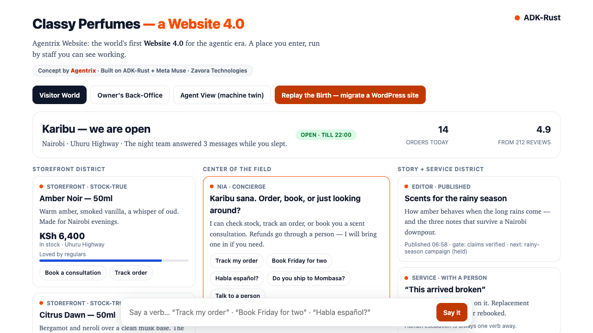
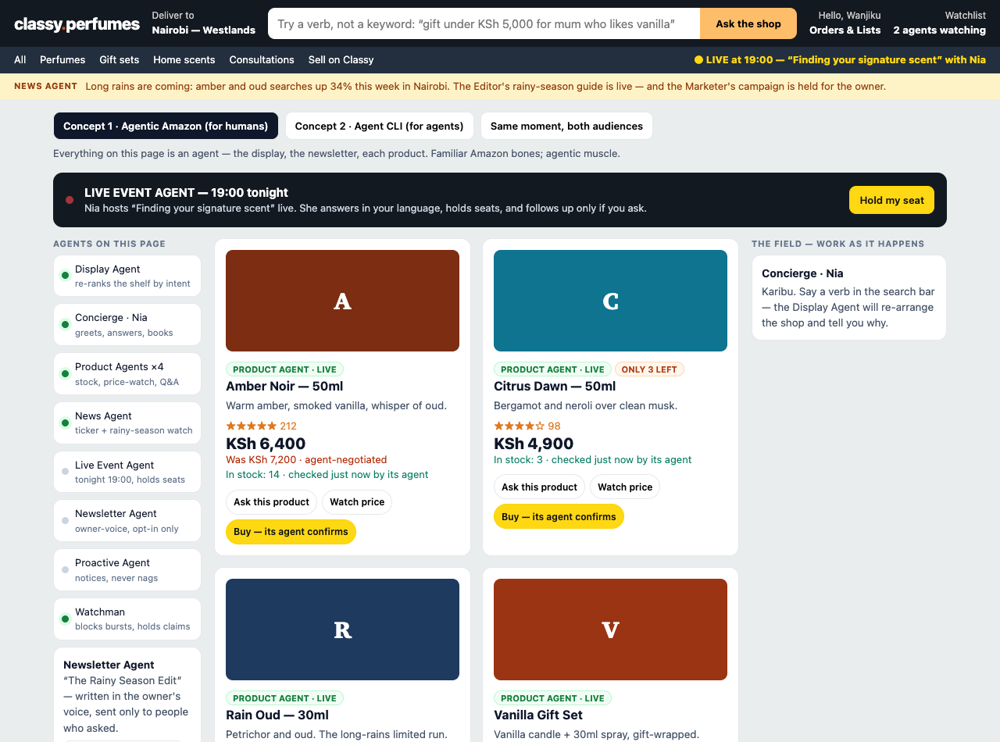
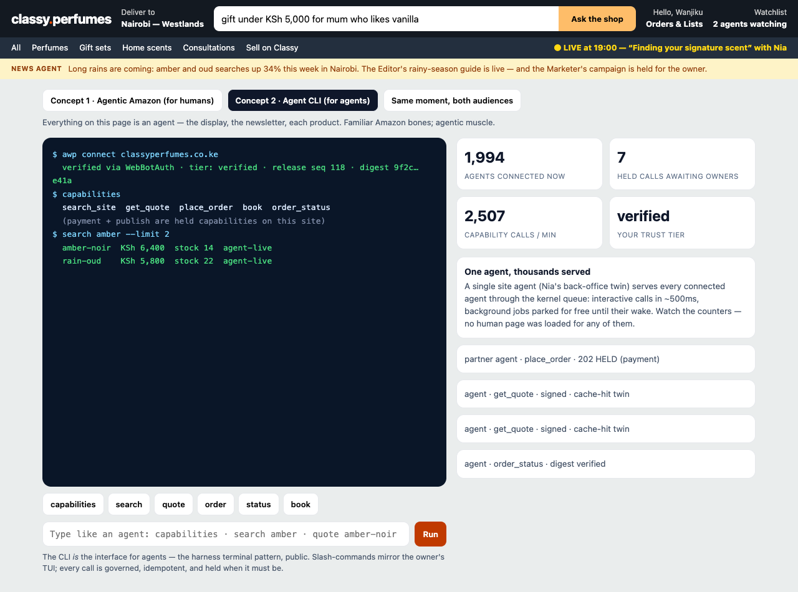
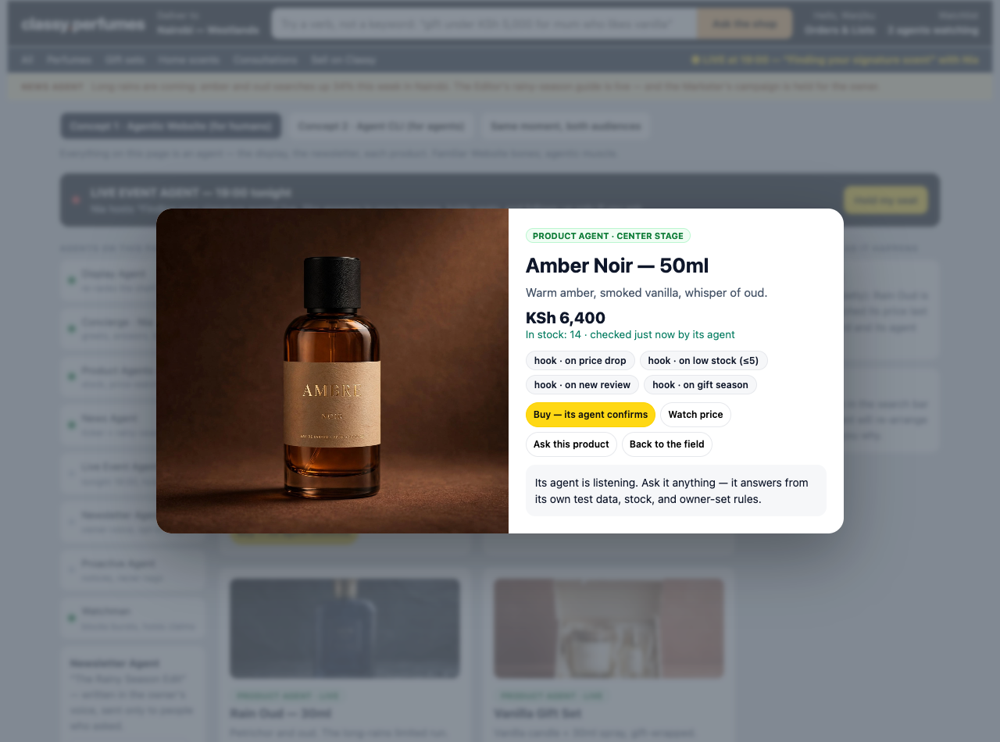
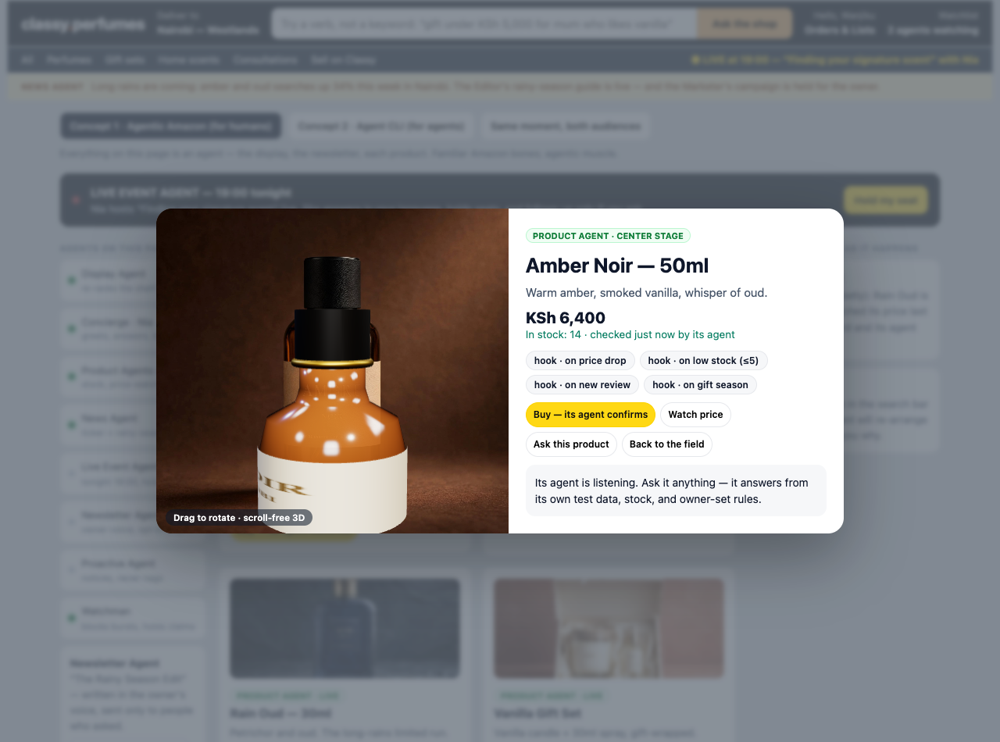

# Agentrix Website

**Introducing the world's first Website 4.0 for the agentic era.**

A product of Zavora Technologies Ltd, built on
[ADK-Rust](https://github.com/zavora-ai/adk-rust) and Meta Muse models.
Agentrix Website extends Agentrix OS — the agentic OS where every app is an
agent, presented in a spatial field with a verb UI — from a person's life to
a business's public presence.

> Websites 1.0 were read. 2.0 were clicked. 3.0 was plumbing.
> **4.0 works**: a website that greets, sells, publishes, supports, and
> defends itself — with the owner approving anything that matters.

## See it

Open [`concept/index.html`](concept/index.html) in a browser (any static
server works, e.g. `python3 -m http.server --directory concept`): a
Classy Perfumes Website 4.0 with the Visitor World, verb bar, Owner's
Back-Office with a scrubbable night, and the Agent View — simulated
in-page and labeled as such.

**Concept 2** — [`concept/v2.html`](concept/v2.html): everything is an
agent on familiar Website bones (Display Agent re-ranks by intent, each
product is a live sub-agent with hooks, News/Live/Newsletter/Proactive
agents on the rails), plus the **Agent CLI** — a public harness-terminal
interface where one site agent serves thousands of connected agents.

**Concept 3** — [`concept/v3.html`](concept/v3.html): Concept 2 with real
generated product photography, the Agentrix spatial field, and center-stage
focus (click any product: the field recedes, its agent takes the center with
hooks/triggers, Q&A, watch and buy). UX polish: keyboard verbs (`/` to ask,
`Esc` to return), focus-visible states, reduced-motion support.

**Concept 4** — [`concept/v4.html`](concept/v4.html): the spatial field in
3D. Product cards lean in 3D toward the pointer, and center stage holds a
real-time three.js perfume bottle (lathe-turned glass, canvas label, studio
environment) you can drag to rotate — per-product colours, with the photo
as fallback.

## Start here

| Document | What it settles |
|---|---|
| [docs/VISUAL_CONCEPT.md](docs/VISUAL_CONCEPT.md) | The complete visual vision: the World, its districts, card taxonomy, verb grammar, motion, dual-audience design |
| [docs/STORYBOARD.md](docs/STORYBOARD.md) | The demo, beat by beat: what the audience sees, what is real, what is labeled |
| [docs/SUBSTRATE.md](docs/SUBSTRATE.md) | How the vision maps onto `adk-kernel`, `adk-harness`, `adk-website`, `adk-awp`, Muse — what exists, what we build |
| [docs/SLICES.md](docs/SLICES.md) | Build order that never compromises the end-state |

## The one-sentence version

Every business already has a website; it just sits there. Agentrix turns any
existing site — WordPress included, no login needed — into a living World
run by visible agents, serving people like a place and AI agents like a
protocol, with the owner on an approval ladder instead of on call.

## Honesty discipline

Inherited from Agentrix OS and kept without exception:

- Nothing is fabricated to look connected. Scripted or recorded behavior is
  labeled as such, in the UI and in the demo script.
- Autonomy is supervised. Holds, approvals, and the freeze switch are
  features shown proudly, never friction hidden from the camera.
- "World's first" claims are scoped to what is demonstrated live.
