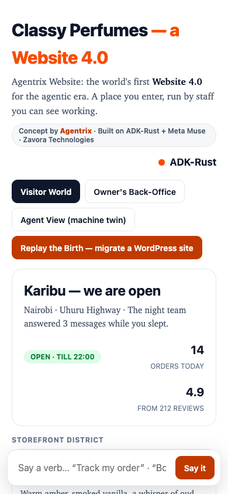

# Agentrix Website

## Introducing the world's first Website 4.0 for the agentic era.

**A website that works for your business — even while you sleep.**

By [Zavora Technologies Ltd](https://github.com/zavora-ai) · Built on
[ADK-Rust](https://github.com/zavora-ai/adk-rust) and Meta Muse ·
[Watch the Day 2 showcase (2:06)](video/out/day2-showcase.mp4) ·
[Posting-size copy (17MB)](video/out/day2-showcase-posting.mp4)

---

## 1. The problem

Websites sit there. The numbers say businesses can no longer afford that:

| The brochure web, quantified | Source |
|---|---|
| **43%** of all websites run WordPress — 200M+ sites on yesterday's model | W3Techs, Oct 2025 |
| **58% fewer clicks** for the #1 result when AI answers first | Ahrefs · 300,000 keywords |
| **47 hours** average reply to a website lead; buyers decide in 5 minutes | HBR / MIT research |
| **$4.4M** average cost of one data breach; ~$120k per attack for small firms | IBM, 2025 |
| **~50%** of all internet traffic is now agents, not people | Imperva |

Your next visitor may not be a person — and a website that cannot serve
agents is invisible to half its audience, while the half it can see waits
47 hours for a reply.

## 2. The solution, simply

> Websites 1.0 were read. 2.0 were clicked. 3.0 was plumbing.
> **4.0 works.**

An **Agentrix Website** greets, sells, publishes, supports, and defends
itself — with the owner approving anything that matters. It is built from
[Agentrix OS](https://github.com/jameskaranja) (every app an agent, a
spatial field, a verb UI) on ADK-Rust's `adk-kernel` (always-on agent
scheduling), `adk-harness` (governed autonomy), `adk-website`/`adk-awp`
(publishing and the agent protocol), and Meta Muse models.

**Migration needs no credentials.** Paste a WordPress, Shopify, or blog
address: the public site is read, rebuilt, and verified — then it starts
working.

## 3. Meet the website's staff

Everything on the website is now an agent:

| Staff member | What it does all day |
|---|---|
| **Concierge** | Greets every visitor in their language, answers, books, qualifies |
| **Display Agent** | Re-arranges the shop around each visitor's intent — and says why |
| **Product Agents** | Each product knows its stock, answers questions, watches prices, confirms orders |
| **Editor** | Drafts content in the owner's voice; publishes only past the gate |
| **News + Newsletter Agents** | Watch the world, write only with approval, send only to the willing |
| **Live Event Agent** | Hosts launches and live sessions, holds seats, follows up |
| **Marketer** | Generates leads, converts, remarkets — inside a budget the owner set |
| **Watchman** | Reads the logs, blocks attacks, holds anything suspicious |
| **Cashier + Keeper** | Money always waits for a human; costs, stock, and the morning update run themselves |

## 4. Two audiences, one truth

| Audience | What they get |
|---|---|
| **People** | A place: calm, beautiful, familiar — never a bot costume |
| **AI agents** | A protocol: a public CLI with verified access, fair prices, and receipts — no scraping |

Same prices, same stock, same signed truth under both. One site agent
serves thousands of connected agents at once; no human page is ever
loaded for them.

## 5. Fully autonomous — inside authority

1. Generate leads ✓
2. Convert visitors ✓
3. Provide support ✓
4. Remarket ✓
5. Give owner updates ✓
6. Manage its own costs ✓
7. Manage inventory ✓

**Owner approves actions when prompted.** Autonomy is a ladder the owner
controls, with a freeze switch — never a leap of faith.

## 6. The journeys we are building

| From | To | The outcome |
|---|---|---|
| WordPress site | Agentrix Website | Becomes the authority in its niche |
| Shopify store | Agentrix Website | Sells around the clock, staffed 24/7 |
| Quiet blog | Agentrix Website | An audience that actually reads and returns |

*Illustrative outcomes — Day 3 makes the first one real.*

## 7. See it, don't read about it

| Concept | Open |
|---|---|
| Visitor World, verb bar, night shift, Agent View | [`concept/index.html`](concept/index.html) |
| Everything is an agent + Agent CLI | [`concept/v2.html`](concept/v2.html) |
| Spatial field, center stage | [`concept/v3.html`](concept/v3.html) |
| 3D product stage | [`concept/v4.html`](concept/v4.html) |
| Day 2 showcase video | [`video/out/day2-showcase.mp4`](video/out/day2-showcase.mp4) |

Serve locally: `python3 -m http.server --directory concept`, then open
`http://127.0.0.1:8000/v4.html`.

## 8. Building in public — the ledger

| Day | Spent | Shipped |
|---|---|---|
| Day 1 | Research + foundation | Thesis, ADK-Rust review, Meta Muse provider |
| Day 2 | Concepts + design + this showcase | Four interactive concepts, complete vision, video |
| **Total** | **$100 of $150** | **$50 remains for implementation** |
| Day 3 | $50, live | **Coding — in this repo, in the open** |

**Feedback wanted:** what should Day 3 build first — the migration, the
concierge, or the night shift? Open an issue or comment on the Day 2 post.

## 9. Where the detail lives

| Document | What it settles |
|---|---|
| [docs/VISUAL_CONCEPT.md](docs/VISUAL_CONCEPT.md) | The complete visual vision |
| [docs/STORYBOARD.md](docs/STORYBOARD.md) | The demo, beat by beat |
| [docs/SUBSTRATE.md](docs/SUBSTRATE.md) | Vision → ADK-Rust, what exists vs what we build |
| [docs/SLICES.md](docs/PLAN.md), [docs/SLICES.md](docs/SLICES.md) | Build order that never compromises the end-state |
| [video/SCRIPT.md](video/SCRIPT.md) | Day 2 script and stat sources |

Honesty discipline, inherited from Agentrix OS: nothing is fabricated to
look connected; scripted or recorded behavior is labeled; autonomy is
supervised and proud of it.

## License

Apache 2.0 — see [LICENSE](LICENSE).
